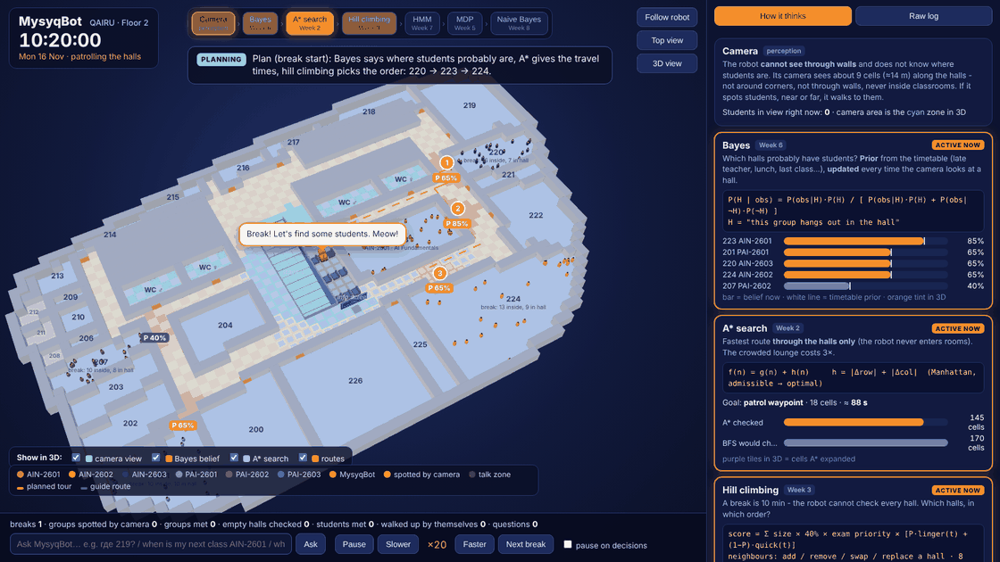

# MysyqBot: QAIRU's robot campus cat 🐱

*AI Fundamentals (AIF1303) final project, QAIRU, 2026*

Other universities have a campus cat. QAIRU has **MysyqBot** (*mysyq* = "cat" in Kazakh):
a small robot on **floor 2** that cheers students up in the halls during breaks and
answers their questions. It never goes inside classrooms.

A real robot is expensive, so this project is a **3D simulation of the real QAIRU floor 2**,
traced from the plan on the lobby info screen: rooms 200–226, two pairs of toilets (♂/♀)
in the solid wall blocks, the central stairs, the lounge with sofas and the ring corridors.

**The robot does not know where students are.** It cannot see through walls; its camera
sees about 9 cells (≈14 m) along the halls, not around corners. It only knows the
timetable, so it has to *reason* about where students probably are, go and look, and walk
over to anyone it spots, near or far.



---

## The problem

When a break starts, only ~40% of each group come out of the classroom. Some groups hang
out for a few minutes, some leave immediately, some teachers finish late. A break is only
10 minutes and the robot is slow, so it must decide:

1. **Where are students probably hanging out?** It can't see them, so it reasons from the
   timetable and from what its camera sees.
2. **How do I get there fastest?** Halls only, around the wall blocks, avoiding the crowded lounge.
3. **Which halls, in which order**, are worth checking in the time left?
4. **How does this group feel, and what should I say?** The mood is hidden.
5. **What does a student want** when they type a question (EN/RU)?

## How the algorithms work together

```
robot patrols the halls with its CAMERA (sees ~9 cells, not through walls)
   │
   ├── a break starts (timetable)
   │     ├─ 1. Bayes ........ prior P(group hangs out in the hall) for each ending lecture
   │     ├─ 2. A* ........... travel times through the halls only
   │     └─ 3. Hill climbing  which halls to check, in which order, in the time left
   │
   ├── camera looks at a hall → Bayes UPDATE ("seen" / "not seen") → re-plan if belief changed
   ├── camera spots students (near or far) → A* straight to them
   │
   ├── meets a group
   │     ├─ 4. HMM .......... P(mood) from today's activity readings (forward + Viterbi)
   │     └─ 5. MDP .......... value iteration → best action for that belief → message
   │
   └── a student asks something
         └─ 6. Naive Bayes .. intent → A* route / timetable answer / AI explanation
```

| # | Algorithm | Course week | File | Input → Output |
|---|---|---|---|---|
| 1 | Bayesian inference | 6 | `bayes.py` | timetable prior + camera observation → P(group hangs out) |
| 2 | A\* search (BFS baseline) | 2 | `astar.py` | map (halls only), start, goal → fastest path |
| 3 | Hill climbing + random restarts | 3 | `tour_planner.py` | beliefs, sizes, travel times, time left → best tour |
| 4 | HMM forward filtering + Viterbi | 7 | `mood_hmm.py` | activity readings → mood belief |
| 5 | MDP value iteration (QMDP) | 5 | `mdp.py` | mood belief → best action |
| 6 | Multinomial Naive Bayes | 8 | `intent_nb.py` | question text → intent |

Algorithms 1, 2 and 5 are the three required groups (Bayes, search, MDP). 3, 4 and 6 are
extra course topics.

---

## How to run

Python 3.9+. The AI and the 3D view use **only the standard library**, and the 3D page is
plain WebGL, so there is nothing to install and no internet is needed. On Mac/Linux, type
`python3` instead of `python`.

```bash
python server3d.py         # ★ 3D simulation, opens http://localhost:8000
python console_demo.py     # the same break as a text story (input → steps → output → why)
python console_demo.py --break 10:20 --ask
python tests.py            # 16 test cases
python evaluate.py         # full-simulation comparison (60 days, ~2-3 min)

pip install matplotlib     # only for: python app.py (2D view), evaluate.py --chart
```

### The 3D view, made for explaining (defense / lecture)
- **Algorithm chain at the top:** *Camera › Bayes › A\* › Hill climbing › HMM › MDP ›
  Naive Bayes*. Whatever the robot is using right now lights up orange; click a chip to
  jump to its card.
- **"What the robot is thinking" caption:** one plain-English sentence, e.g. *"Going to
  check the hall of 223 – Bayes: 85% chance the group hangs out there."*
- **Algorithm cards (right panel):** each card shows what the algorithm is for, its
  formula, and the **latest numbers plugged into the formula**:
  - **Bayes:** P(H|seen) = 0.90·0.47 / (…) = 0.62, plus belief bars per hall, with a white
    line marking the prior.
  - **A\*:** the goal, the cost, and how many cells A\* checked versus BFS.
  - **Hill climbing:** every step (add / swap / remove), the score, the best tour and the
    halls it skipped.
  - **HMM:** the readings, the mood bars and the Viterbi path.
  - **MDP:** Q-values per action, the chosen action and the policy table.
  - **Naive Bayes:** the question, its tokens and the intent probabilities.
- **3D layers (toggle):** *camera view* (cyan, what the robot can see right now),
  *Bayes belief* (orange tint and P% over each hall), *A\* search* (purple, the cells A\*
  expanded), *routes* (numbered tour stops and dashed path). Students the camera has
  noticed get a yellow ring.
- **"pause on decisions":** the simulation stops every time the robot makes a decision
  (plan, action, answer), so you can explain the highlighted card, then press **Play**.
- **Raw log tab:** the full text trace of every step.
- **Student questions are visible:** the asking student gets a blue speech bubble, and
  the *Questions to MysyqBot* feed shows each question, how Naive Bayes understood it
  (intent + %) and the cat's answer.
- **Ask box:** type `где 219?`, `где женский туалет?`, `when is my next class AIN-2601`,
  `what is a heuristic?`, `я устал`, …
- **Camera:** drag to rotate, right-drag to move, use the wheel to zoom. *Follow robot*
  and *Top view* set the camera for you.

### Project files
```
campus.py        floor-2 map (traced from the photo), rooms, meeting spots, timetable loading
data/            timetable.csv, deadlines.csv  ← replace with the real QAIRU schedule
astar.py  bayes.py  tour_planner.py  mood_hmm.py  mdp.py  intent_nb.py   ← the AI
robot.py         MysyqBrain: planning, mood decision, question answering
world.py         simulator: camera + line of sight, belief, patrol, hidden truth, students
server3d.py      runs the simulation and serves the 3D page (stdlib http.server)
web/             index.html, viewer.js (WebGL renderer + explanation panel), style.css
console_demo.py  terminal story of one break
evaluate.py      full-simulation experiments + per-algorithm checks → results/
tests.py         16 test cases
app.py           2D matplotlib version (backup)
tools/gen_map.py traces tools/qairu_floor2.png into the grid map
```

---

## Sample output (console_demo.py, break at 14:40, seed 7)

```
=== BREAK 14:40: 5 lectures end (202, 218, 220, 223, 224) ===
[Bayes] priors from the timetable (the robot cannot see the students yet):
  202 AIN-2602: P(group hangs out) = 0.65 (short break, next class soon)
  223 AIN-2603: P(group hangs out) = 0.85 (teacher usually finishes late)
[Hill climbing] plan (break start) at 14:40:00, 600s left in the break
[A*] travel times in the halls: 202 15s, 218 152s, 220 140s, 223 115s, 224 85s
     add 202@0 -> 202  score 11.5 · add 223@1 -> 202>223  18.7 · add 220@2 -> 202>223>220  20.5
  BEST tour: 202 > 223 > 220   skipped: 218, 224 (not worth the time)
14:40:04 [camera] I see 1 student(s) 5 cells away (AIN-2602) -> going to them
14:40:08 meeting AIN-2602 in the hall near 202
[HMM] readings today: ['Active', 'Active', 'Calm'] -> belief Tired 0.64
[MDP] Motivate 32.7, Joke 33.6, MiniQuiz 28.4, LeaveAlone 29.4 -> action: Joke
[Bayes] camera looks at the 202 hall (50s after class): seen -> P(group hangs out) 0.71 -> 0.91
14:41:09 A AIN-2602 STUDENT ASKS: what is a heuristic?
[Naive Bayes] course_help 0.93 -> "A heuristic is a quick estimate of the distance to the goal..."
[Bayes] camera looks at the 224 hall (229s after class): not seen -> P(group hangs out) 0.54 -> 0.44
[Hill climbing] plan (after meeting a group) ... BEST tour: 223 > 220
```

---

## Results (`python evaluate.py`: 60 simulated days, 300 breaks, full simulation)

All robots have **the same camera** and all walk to any students they see; only the
"brain" differs. The simulator knows the hidden truth, so it can measure how good the
robot's decisions really are.

| Strategy | Students met / break | Trips to an empty hall |
|---|---|---|
| **MysyqBot** (Bayes + camera updates + hill climbing) | **8.7 ± 0.3** | **32%** |
| Same, but Bayes ignores the camera | 8.7 ± 0.3 | 36% |
| Nearest halls first (no probabilities) | 8.0 ± 0.2 | 36% |
| Random wandering | 6.5 ± 0.2 | — |


| Algorithm | Metric | Ours | Baseline |
|---|---|---|---|
| Bayes (camera) | correct "group hangs out?" for halls it looked at | **91.9%** | timetable prior only 70.8% |
| Bayes (camera) | Brier score (lower = better) | 0.060 | prior only 0.202 |
| A\* | cells expanded | 96.6 | BFS 280.1 |
| A\* | path cost | 32.5 | BFS 33.8 |
| Hill climbing | found the true optimum | 100% of 300 plans | exhaustive search |
| HMM + MDP | value of the chosen action | 34.09 | latest reading 33.72 · always Motivate 33.33 · true mood 35.99 |
| Naive Bayes | intent accuracy (leave-one-out, 120 EN/RU examples) | 79.2% | majority class ≈ 20% |

**Honest discussion**
- **Planning pays off:** with the same camera, MysyqBot meets **+35%** more students than
  random wandering and **+9%** more than nearest-first.
- **Camera updates make the belief much more accurate** (91.9% vs 70.8%), and the robot
  makes fewer trips to empty halls (32% vs 36%). They don't add students met here,
  because the robot usually spots groups on the way anyway.
- **Right after class, "seen" proves little:** every group is still in the hall at that
  point, so Bayes barely changes. The robot waits 20 s before drawing conclusions. This
  is a nice example for the defense.
- **Mood accuracy alone equals trusting the last reading** (68%). The benefit of the HMM
  shows up in decisions, because its probabilities let the MDP choose better actions.

## Assumptions (toy model, as allowed by the guidelines)
- **Map:** traced from a photo of the floor-2 plan (`tools/qairu_floor2.png`). One cell
  ≈ 1.6 m. Doors follow the marks on the plan. Rooms 208, 211 and 212 have no corridor
  door, so they are treated as offices. The dark blocks on the plan are solid walls; about
  40% of their area are toilets (WC ♂ and WC ♀ on the left and on the right).
- **Camera:** 9 cells range with line of sight. Walls and rooms block it; halls,
  doorways and the stairs don't. It notices a visible student with probability
  0.95 when close and 0.6 at the edge. Bayes model: P(seen|H) = 0.9·linger(t),
  P(seen|¬H) = 0.9·quick(t) + 0.03.
- **Timetable:** invented, QAIRU-style: 80-minute classes, 6 groups (AIN = AI Nation,
  PAI = Physical AI), 22 lectures.
- **Breaks:** 40% of each group come out. A group that hangs out stays ~4 min
  (exponential); otherwise it is gone within 1 min. "Late" teachers finish 2–4 min late.
- **Robot:** 2.5 s per cell, and the lounge costs 3×. Each meeting takes 120 s. A break
  is 600 s.
- **Curious students:** students within 7 cells of a meeting walk up with probability 0.5,
  and someone asks a question with probability 0.6.
- **Privacy by design:** the camera only detects that people are there. No face
  recognition, no recording, and the robot never enters classrooms.

## Future development
- The real QAIRU timetable and the info-screen data as a live input.
- Learning the priors from real observations instead of hand-set rules, and Q-learning
  from 👍/👎 feedback on the robot's screen.
- Several floors via the lift, and 2 robots sharing one belief map (multi-agent).
- A real robot in the Physical AI track: a Raspberry Pi with a camera running the same
  Python brain.

## Suggested team split (each person owns ~2 files for the defense)
| Member | Owns | Must explain |
|---|---|---|
| 1 | `astar.py`, `campus.py` | f = g + h, admissible Manhattan heuristic, halls-only search, A\* vs BFS |
| 2 | `bayes.py`, `intent_nb.py` | prior → camera update by hand, why "seen" right after class means little, Laplace smoothing |
| 3 | `tour_planner.py`, `world.py` | score function, neighbours, local optimum, restarts, re-planning, camera/line of sight |
| 4 | `mood_hmm.py`, `mdp.py` | forward vs Viterbi, Bellman update, γ, QMDP |

## AI use declaration
The course requires an AI Use Declaration (syllabus appendix). Fill it in before you
submit: tool (Claude), purpose (code scaffolding, explanations), what was generated,
and **how you verified it** (tests.py, evaluate.py, manual Bayes calculations). Every team
member must be able to explain all the code.
